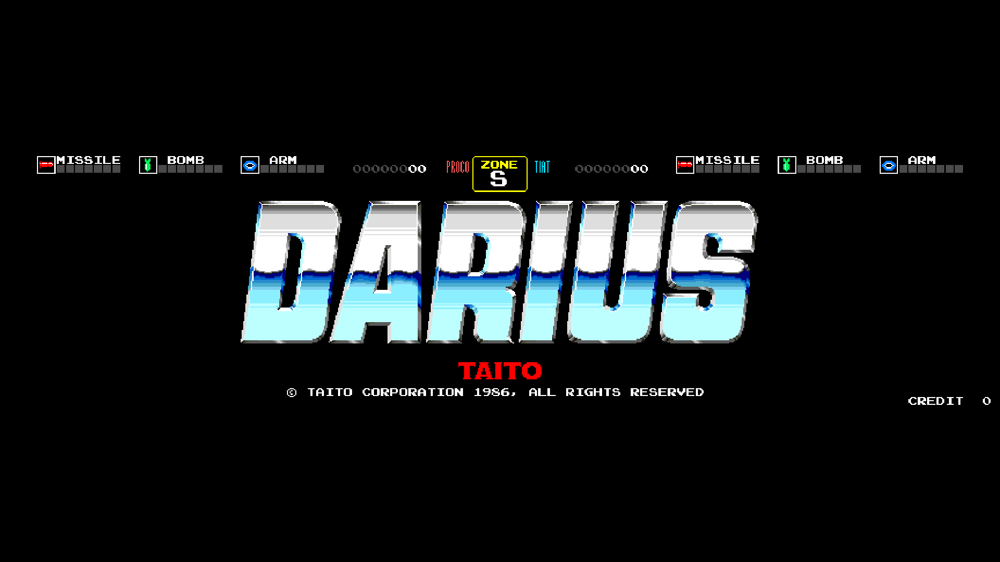
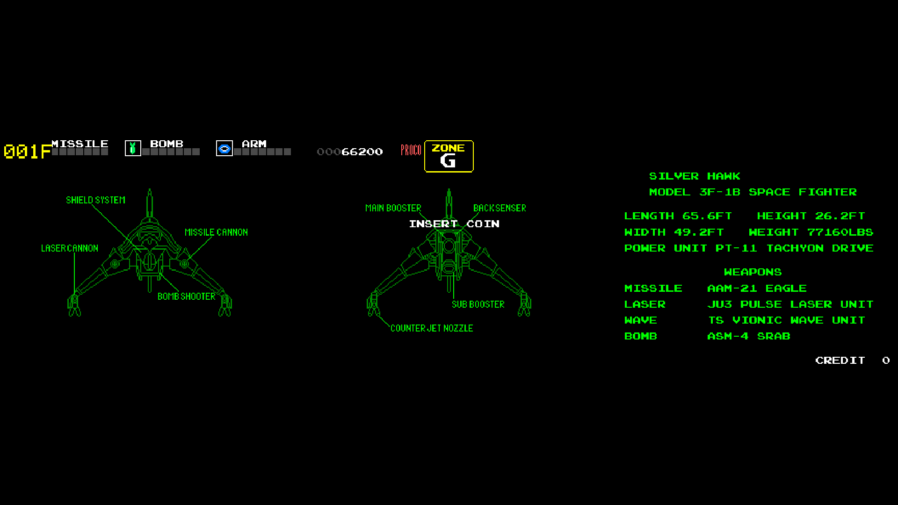
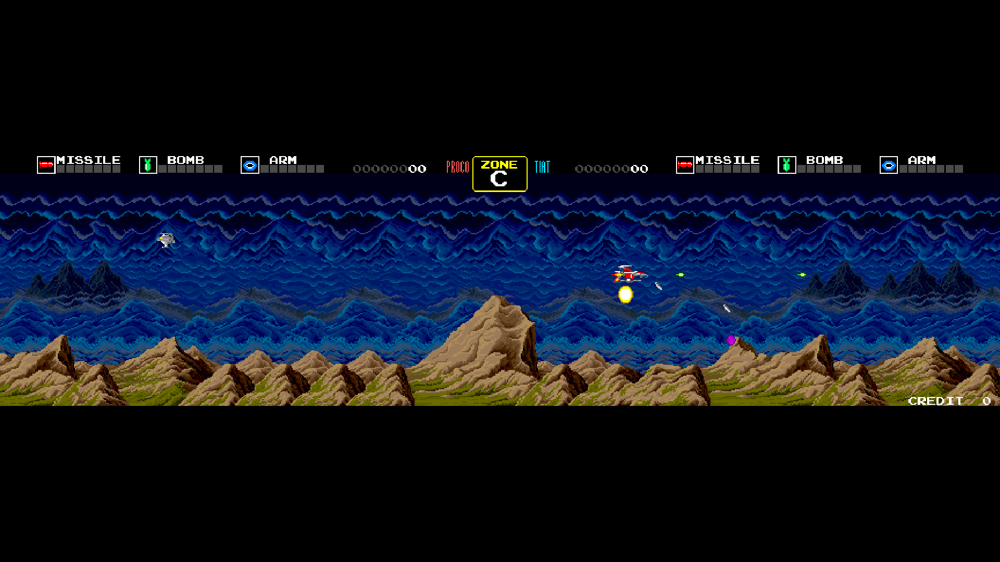
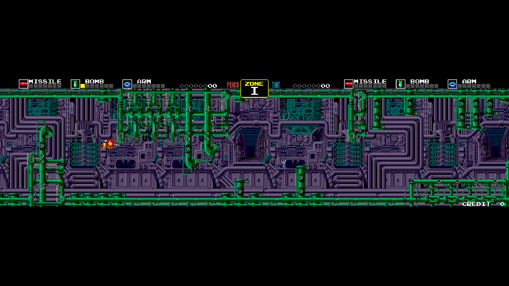
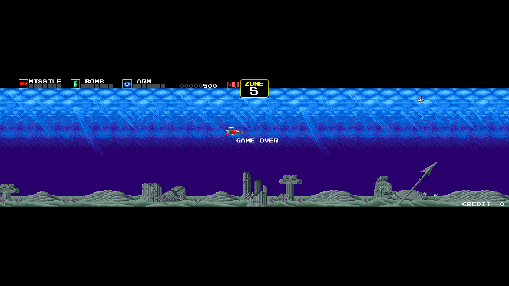
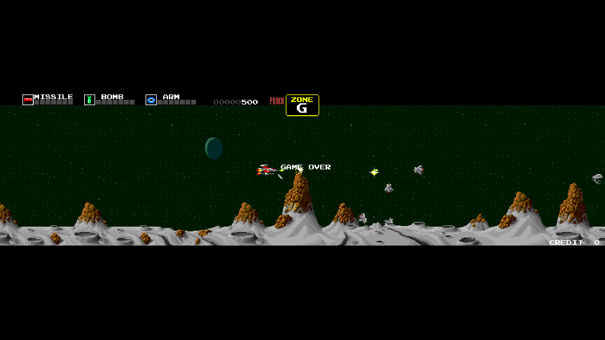

# rm-Darius_MiSTer

FPGA core for **Darius** (Taito Corporation, 1986) targeting the
[MiSTer FPGA](https://github.com/MiSTer-devel) platform (Terasic DE10-Nano).

Darius runs on a **dual 68000 + Z80 ×2 board** with two PC080SN tile layers,
PC090OJ sprites, PC060HA master/slave communication, and **YM2203 ×2 +
MSM5205** audio, driving the game's signature **triple-screen** ultra-wide
display. This core reimplements the hardware in SystemVerilog from MAME
references and hardware observation on original PCBs.

**All four processors and the SDRAM controller are my own designs**, each
written from scratch and published in its own repository:
[rm68000](https://github.com/rmonic79/rm68000) for the two 68000s,
[rmZ80](https://github.com/rmonic79/rmZ80) for the two Z80s and
[rmSdram](https://github.com/rmonic79/rmSdram_MiSTer) for the SDRAM.

---

# The `rm` version

*This section explains what the `rm` line is and what it adds in this core.
Skip it if you already know.*

**`rm` cores are my own builds, published outside the MiSTer-devel tree.** They
are not a fork of the emulation: the core is the same one I contribute
upstream, plus what the official tree cannot host.

In the other `rm` cores that means two things: CRT geometry controls placed in
the `sys/` framework, so that HDMI stays bit-identical while you adjust a tube,
and the pause overlay. **In Darius the `rm` version adds only the pause
overlay.** The CRT controls of this core — CRT Adjust and CRT Shrink — sit
inside the core, not in `sys/`: they are part of the core itself, and HDMI
follows CRT Adjust while it is on (see [CRT Adjust](#crt-adjust)).

### Pause overlay

Logo, supporters list and scrolling credits, shown while the game is paused.

### Naming

| | |
|---|---|
| repository / folder | `rm-<Title>_MiSTer` |
| Quartus project and RBF | `rm<Title>` |
| MRA files | `rm <Title> (…).mra` |

The `rm` RBF has a **different file name** from the official core, so the two
can sit on the same SD card without overwriting each other, and you choose
which one to launch from the MRA.

### What the MiSTer-devel version has instead

Everything else, identically: the processors, savestates, audio work, video
fixes, the CRT controls, hardware accuracy. What it does **not** have is the
pause overlay.

---

## About the game

**Darius** is Taito's landmark horizontal shoot-'em-up, famous for its
**three-monitor ultra-wide screen** and its all-aquatic-themed mechanical
bosses. You pilot the **Silver Hawk** starfighter through a branching tree of
zones (pick your path at the end of each stage), fighting waves of enemies to
a memorable Zuntata soundtrack, with the iconic "Warning!! A huge battleship
is approaching" boss cadence. The board composes three horizontal panels into
one continuous 864-pixel-wide playfield.

## Status

**Current version: 1.9** (November 2026).

The core runs the full game end-to-end on all supported ROM sets and has been
tested on real MiSTer hardware.

## What's new in 1.9

### Own processors and SDRAM controller

Version 1.9 replaces every processor of the board, and the SDRAM controller,
with designs of my own. **No third-party processor or SDRAM code is left in
the core.**

**rm68000 — the two 68000s (main and sub CPU).**
[rm68000](https://github.com/rmonic79/rm68000) is a from-scratch
implementation of the Motorola MC68000, written from the manufacturer's
documentation and from the published analysis of the die — the micro ROM,
the nano ROM, the ALU matrices and the register-file tables printed in the
original Motorola patent. It reproduces the 68000 **tick for tick**: the same
bus accesses, in the same order, on the same cycles, with the same pacing. It
works the way the silicon does, with two non-overlapping clock phases and
two-level microcode, and its tables are generated from the die data, not
typed by hand.
- Every block has an exhaustive bench against a model independent of the RTL
  (all 1024 microcode addresses, all 65,536 instruction words for the
  decoders, every cell of the ALU matrix on every byte pair), plus the
  whole-CPU benches: every addressing mode, every exception path, interrupts,
  STOP, bus arbitration.
- In Darius it runs both CPUs with its **DTACK generator inside the CPU node**:
  the bus cycle is stretched while the SDRAM is busy, and the cycles lost to a
  stall are recovered, so the CPUs keep the pace of the original board.
- The **savestate of the two 68000s** is rm68000's external savestate: it
  pauses both CPUs and reads out and restores their entire architectural
  state, without a debug port inside the processor.

**rmZ80 — the two Z80s (music CPU and ADPCM/sound-effects CPU).**
[rmZ80](https://github.com/rmonic79/rmZ80) is a from-scratch implementation
of the Zilog Z80, written from the manufacturer's documentation and from
published measurements of the chip. It reproduces the Z80 **T-state for
T-state**: every instruction, prefix and interrupt response takes the same
number of T-states as the chip, with the same M-cycles in the same order, and
the bus is driven at **half-T-state resolution**. The undocumented behaviour is
included: the flags in bits 5 and 3, `WZ` (MEMPTR), `SLL`, the halves of IX and
IY, the unassigned `ED` and `DD`/`FD` positions.
- It is small: the control is decoded directly instead of microcoded, the
  registers are flip-flops, and it uses no block memory.
- Its complete state can be read at any time and loaded in one clock, which
  is what the savestate of the audio CPUs uses.
- In Darius both Z80s are paced by two clock enables per T-state. In pause the
  clock-enable counter stops, so on resume the CPUs stay locked to the same
  half T-state of the YM2203s; after a restore it is put back on the half
  T-state the restored CPU was in. The audio bench runs the CPUs through 57
  pauses, 57 state reloads and 57 resumes and gets the same YM writes and
  PC060HA accesses, on the same T-states, as a run without pauses.

**rmSdram — the SDRAM controller.**
[rmSdram](https://github.com/rmonic79/rmSdram_MiSTer) is a single-clock SDRAM
controller: it keeps one row open per bank, overlaps the banks (while one
operation holds the data bus, the next bank is activated or precharged on the
free command cycles) and buffers writes, so loading the ROMs does not block the
readers. Every chip timing is a parameter in picoseconds.
- **Each graphics client has its own port**: the three panels and the sprites
  read in parallel, and each 32-bit read is one job of two words instead of two
  16-bit accesses in a row.
- It drives **one chip with 9-bit columns**, so the core now runs on **every
  MiSTer SDRAM module: 32, 64 and 128 MB**.
- The SDRAM clock comes from a dedicated PLL output, at 180°, and the point
  where read data is captured is set from the pin delays measured on the build.

### System

- **48 MHz system clock** (was 96 MHz). The dividers were halved, so the CPUs,
  the audio chips and the pixel clock keep their frequencies. The panel
  renderers at 48 MHz give the same pixels as at 96 MHz (774,144 pixels
  compared, 0 differences).
- **sys/ framework** updated to the current MiSTer framework (audio volume
  boost from the menu, new Main commands).

### Video

- **CRT Shrink** — new: the picture compressed vertically to 1/2, 1/3 or 1/4,
  for CRTs, without a frame buffer and without moving the sync. See
  [CRT Shrink](#crt-shrink) for how it works.
- **CRT Shrink Interlace** — new: an interlaced mode that shows, over two
  fields, twice the lines of the plain shrink (with 1/2, all 224 lines of the
  picture).
- **Sprites locked to the shrink grid** (1/2 and 1/4): a sprite moving by one
  line no longer bobs up and down between frames.
- **CRT Adjust, H-Position**: the picture moves left **without disappearing
  into the blanking**, and the range grows from ±48 to −64…+63 steps of 4
  pixels.
- **CRT Adjust, H-Size**: the picture now stretches and squeezes around its
  **centre**, which stays in place; before, it grew to the right and shrank to
  the left.
- **CRT Adjust with the interlaced shrink**: the vertical sync keeps its
  position within the line, so the two fields stay interlaced.
- **Follow views**: the last line of the picture (line 223) is now visible on a
  CRT, and with the shrink the first line of the window no longer shows the
  bottom of the previous frame.
- **VRAM arbiter fix**: after a turn to the centre panel, the centre panel was
  no longer served until a side panel asked — the line glitch on the
  wireframe ships of the attract sequence is gone.
- **Panel renderer in three stages** (VRAM, graphics ROM, drawing): the waits
  overlap instead of adding up, with no broken lines up to an average ROM wait
  of 875 ns.
- **Sprite RAM**: when the main and sub CPUs write in the same clock, the sub
  CPU's write is no longer lost.

### Audio

- **Audio matched to MAME.** The core's final output was compared with MAME's,
  sound by sound (waveform and spectrum), on the game's 47 sounds, and every
  correction comes from that comparison:
  - the PSG DC-removal filter works on 9 bits: at 8 bits the output folded over
    and the square wave was asymmetric (even harmonics at −24 dB);
  - the PSG volume table, measured from a volume sweep;
  - the mixer gains between FM, PSG and ADPCM: the PSG was 11.5 dB and the ADPCM
    5.9 dB louder than in MAME relative to the FM, and the mix lost 4–5 dB of
    bass;
  - the PSG tone volume and envelope levels, as measured on MAME's output.
  
  Result: FM, PSG and ADPCM at the same distance from MAME, and the mix
  equalization within about 1 dB from 50 Hz to 16 kHz.

### Other

- **Pause overlay**: supporters list updated.
- Savestates made with earlier versions cannot be loaded (the 68000 savestate
  format changed with rm68000).

## Features

- Dual 68000 main/sub @ 8 MHz with shared RAM (**rm68000**)
- Two Z80 sound CPUs (music + ADPCM/FX) @ 4 MHz (**rmZ80**)
- SDRAM controller with one port per graphics client (**rmSdram**), on any
  MiSTer SDRAM module
- Three horizontal panels composed into the 864-pixel virtual screen
- Sprite renderer with priority, flip, 16×16 4bpp tiles, **buffered sprite RAM**
  and a sprite-ROM cache
- FG text/HUD layer with local BRAM text ROM
- Palette with MAME-verified byte order
- Audio: YM2203 ×2 (FM + PSG) + MSM5205 ADPCM, with a **per-channel gain** for
  each of the nine channels in the OSD
- PC060HA main/sub communication
- Experimental savestate (16 slots) from the OSD
- Experimental **screen views** for one monitor: Follow, Follow 4:3+, Follow
  Wide, Screen Jump, and Triple CRT Wide
- **CRT Adjust** (H-Size, H-Position, V-Shift) and **CRT Shrink** (1/2, 1/3,
  1/4, with an interlaced mode)
- Inputs (coin, start, 8-way joystick) and full DIP switch support
- MiSTer OSD with video, audio-mix, pause and DIP options
- Pause overlay with project logo, scrolling supporters list and social links
- "Clean Pause" OSD option (pause without dim/logo overlay)

**ROM sets supported**
- Darius (World) (`darius`) — reference set
- Darius (US) (`dariusu`)
- Darius (Japan) (`dariuso`)
- Darius (Japan, rev 1) (`dariusj`)
- Darius Extra Version (Japan) (`dariuse`)

## CRT Shrink

Darius was built for three monitors side by side: its picture is 864 pixels
wide and 224 lines tall. On one CRT the whole width fits in a line (Triple CRT
Wide), but then the picture is three times too tall for its width. **CRT
Shrink** compresses it vertically, so the triple screen keeps proportions
close to the original cabinet — **1/3** gives the proportions of the three
monitors — while the CRT keeps receiving its native 15 kHz signal.

| CRT Shrink | Window | Source lines per display line |
|------------|--------|-------------------------------|
| Off        | 224 lines | 1 |
| 1/2        | 112 lines | 2 (every other line) |
| 1/3        | 75 lines  | about 3 |
| 1/4        | 56 lines  | 4 (one line in four) |

**It is not a scaler, and it has no frame buffer.** No line is stored and no
line is moved in time. The window is centred in the frame, and for each
display line inside it the core asks the renderers — the tile panels, the
sprites and the text layer — to draw one source line, advancing by 224/N
source lines per display line (an 8.8 fixed-point accumulator, the only state
the module keeps). The renderers prepare that line during the line before, as
they always do, so the picture comes out of the renderers already compressed.
Outside the window the renderers stay idle and the lines are black. The
horizontal and vertical sync are untouched: the CRT sees the same signal as
without the shrink, so it never loses lock. 1/2 and 1/4 are exact integer
ratios, so the lines are dropped uniformly.

The game itself does not notice: its line interrupt, the savestate and the
follow views keep using the natural line count of the frame, and the sprite
list is copied at the natural line 224, as without the shrink.

**Interlaced mode** (CRT Shrink Interlace, for CRTs). The plain shrink drops
lines: with 1/2, one source line in two is never shown. The interlaced mode
alternates two fields:
- the even field has 263 lines, with the vertical sync starting in the middle
  of a line; the odd field has 262 lines, with the vertical sync at the start
  of a line: 262.5 lines between two syncs, so the CRT draws the odd field half
  a line below the even one;
- the odd field shows the source lines half a step further on (with 1/2: lines
  1, 3, 5… while the even field shows 0, 2, 4…).

Over two fields the CRT shows twice the lines of the plain shrink — with 1/2,
all 224 lines of the picture. The field is signalled to the framework on
`VGA_F1`.

**Sprites on the shrink grid.** The window takes its source lines on a fixed
grid (with 1/2: 0, 2, 4…). A sprite that moves down by one source line would
show its even rows in one frame and its odd rows, half a line lower, in the
next: it would bob up and down, especially on diagonals. With 1/2 and 1/4 the
vertical position of every sprite is rounded to the grid, so each sprite always
shows the same rows of itself: without interlace it moves by whole display
lines; with interlace the even field always shows its even rows and the odd
field its odd rows, half a line lower. 1/3 has no rounding: its grid has a step
of 3, while the objects are made of 16-line pieces, which would round to
different lines and split the object.

The shrink works together with CRT Adjust (with the interlaced shrink, the
vertical sync keeps its position within the line through the line buffer) and
with the follow views.

## CRT Adjust

**CRT Adjust** is an analog CRT geometry / alignment tool in the OSD: a single
line buffer that provides **three live controls** for lining the image up on a
real CRT.

| Control        | What it does                                                       |
|----------------|--------------------------------------------------------------------|
| **H-Size**     | Horizontal stretch / squeeze, −16 to +15 — **integer** (every source pixel is emitted for a whole number of pixel clocks), around the centre of the picture, which stays in place |
| **H-Position** | Horizontal image shift, −64 to +63 steps of 4 pixels — moves the picture **content**, not the sync |
| **V-Shift**    | Vertical line shift, −16 to +15                                     |

**Why it never desyncs the CRT.** The picture **content** is shifted and
resized through the line buffer while the horizontal/vertical **sync signals
stay native**. The CRT keeps its lock at all times, so you can slide and resize
the image **live** without the screen rolling or losing hold.

Because the resize is **integer** (no fractional ratio, no per-pixel
nearest-neighbor) and the output is the byte-exact source pixel, there is **no
shimmering** on moving content and **no blending / blur**.

The module sits in the core, at the video-output boundary. The adjustment
reaches the analog output **and HDMI follows it too**: leave CRT Adjust **Off**
(default) for an untouched HDMI image, and turn it on when aligning on an
analog CRT.

## Screen views (experimental)

On a single display the native 864-pixel triple panel is a very wide, short
image. The core adds display modes that reshape it for one monitor **without
touching the game logic** and while keeping the native 15.7 kHz line rate.

The picture is captured **after** the compositor, buffered per line
(lossless), and re-emitted into a **wider active window** with **integer pixel
repeat** — so the image genuinely grows on a CRT with no blur and no shimmer.

| Screen View       | What you get                                                    |
|-------------------|-----------------------------------------------------------------|
| **Triple**        | Native triple panel (864 px) — unchanged                        |
| **Follow**        | 288-pixel window (one panel) that follows the Silver Hawk       |
| **Follow 4:3+**   | 320-pixel window that follows the Silver Hawk                   |
| **Follow Wide**   | 432-pixel window (about one and a half panels) that follows the Silver Hawk |
| **Screen Jump**   | 288-pixel window that **jumps** panel to panel with the action  |

The follow views track the ship (deadzone + smooth slew, updated at the end of
vblank) and ease back to the playfield centre when the ship is absent (title,
death).

**Triple CRT Wide** re-emits the native triple screen at a wider integer rate
(864 active pixels over about 1018 slots), so the whole triple screen fills a
CRT line — integer 1:1 repeat, no scaling.

All of the above are opt-in from the OSD and leave the default **Triple** view
untouched.

## Screenshots

| | |
|---|---|
|  |  |
| Title screen | Attract — Silver Hawk briefing |
|  |  |
| Zone C | Zone I |
|  |  |
| Zone S | Zone G |

## Hardware emulated

| Component        | Spec                                                     |
|------------------|----------------------------------------------------------|
| Main CPU         | Motorola 68000 @ 8 MHz (rm68000)                         |
| Sub CPU          | Motorola 68000 @ 8 MHz (rm68000)                         |
| Sound CPU        | Z80 ×2 @ 4 MHz — music + ADPCM/FX (rmZ80)                |
| Sound chip 1     | Yamaha YM2203 OPN ×2 — FM + SSG/PSG (jt12)               |
| Sound chip 2     | OKI MSM5205 ADPCM (jt5205)                               |
| Tilemaps         | Taito PC080SN ×2 (two scrolling tile layers)             |
| Sprites          | Taito PC090OJ (16×16 4bpp, buffered sprite RAM)          |
| Comms            | Taito PC060HA (master/slave)                             |
| Display          | Triple horizontal panels → 864×224                       |

## Hardware requirements

- Terasic DE10-Nano
- MiSTer I/O board (recommended)
- SDRAM module (32 MB, 64 MB or 128 MB)
- DDR3 memory (built into DE10-Nano)
- Works on HDMI displays and on CRTs via the analog video output

## Building from source

Requires Quartus Prime 17.0 (free Lite Edition).

```
Open rmDarius.qpf in Quartus → Processing → Start Compilation
```

Output bitstream is generated in `output_files/rmDarius.rbf`.

## Running on MiSTer

The [releases/](releases/) folder contains the parent MRA and a
prebuilt RBF; the other ROM sets are in
[releases/_alternatives/_Darius/](releases/_alternatives/_Darius/):

- `rm Darius (World).mra` — parent MRA
- `rmDarius_YYYYMMDD.rbf` — prebuilt bitstream
- `_alternatives/_Darius/rm Darius (US).mra` / `rm Darius (Japan).mra` /
  `rm Darius (Japan, rev 1).mra` / `rm Darius Extra Version (Japan).mra`

Steps:

1. Copy the `.rbf` to `_Arcade/cores/` on the MiSTer SD card, renamed to
   `rmDarius.rbf` — that is the name the MRA looks for. The official
   core keeps its own name, so both can sit there together.
2. Copy the `.mra` file(s) to `_Arcade/` on the MiSTer SD card.
3. Provide your legally-owned `darius.zip` (or the zip of another set) where
   the MRA expects it (usually in `games/mame/`).
4. The core OSD defaults to **Narrower HV-Integer** scale, which gives an
   integer-scaled image on HDMI displays. V-Integer and HV-Integer are also
   available.

**ROMs are NOT included in this repository.** You must provide them yourself.

## Repository layout

```
rm-Darius_MiSTer/
├── rtl/
│   ├── darius/      Darius-specific core RTL
│   ├── rm68000/     rm68000 MC68000 core
│   ├── rmZ80/       rmZ80 Z80 core
│   ├── rmSdram/     rmSdram SDRAM controller
│   ├── jt12/        YM2203 FM synth, with the JT49 PSG
│   ├── jt5205/      MSM5205 ADPCM
│   └── pll/         Clock PLL
├── sys/             MiSTer framework (Sorgelig / MiSTer-devel)
├── logo/            Pause overlay assets (font, logo, supporter list)
├── docs/            In-game screenshots
├── releases/        Parent MRA + other ROM sets + prebuilt RBF
├── rmDarius.qpf     Quartus project
├── rmDarius.qsf     Quartus assignments
├── Template.sv      Top-level wrapper
├── Template.sdc     Timing constraints
├── files.qip        HDL file list
└── README.md        This file
```

## Acknowledgements

- **Jose Tejada** ([@jotego](https://github.com/jotego)) for JT12 (YM2203),
  JT49 (PSG), JT5205 (MSM5205) and the JTFRAME DC-removal filter.
- **Martin Donlon** ([wickerwaka](https://github.com/wickerwaka)) for the
  savestate infrastructure, ported from the Arcade-TaitoF2 core.
- The **MAMEDev team** for the invaluable reference on the Taito PC080SN /
  PC090OJ / PC060HA hardware, memory maps and timing.
- **Sorgelig** and the **MiSTer-devel team** for the framework, the DDR3
  adapter and Template.
- **Andrea Bogazzi** ([@asturur](https://github.com/asturur)) for help with the
  CRT Adjust implementation.

Full list in [AUTHORS.md](AUTHORS.md).

## Support this project

If you enjoy this core and want to support its development:

- [Ko-fi](https://ko-fi.com/ibecerivideoludici) — one-time support
- [Patreon](https://www.patreon.com/IBeceriVideoludici) — monthly support
- [PayPal](https://www.paypal.me/IBeceriVideoludici) — one-time donation

## Follow

- [GitHub](https://github.com/rmonic79)
- [Twitch](https://twitch.tv/ibecerivideoludici) — live streams
- [YouTube](https://www.youtube.com/c/IBeceriVideoludici) — playlists and videos
- [X / Twitter](https://x.com/rmonic79)

## License

The core as a whole is distributed under **GNU GPL v3 or later** (see `LICENSE`);
third-party files keep their original copyright and license, listed in
[AUTHORS.md](AUTHORS.md). It is provided as-is for educational and preservation
purposes. Original ROM data is not included; users must provide their own legally
obtained copies.

Original *Darius* arcade hardware © Taito Corporation, 1986.
